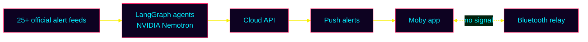

<!-- ░▒▓ HEADER ▓▒░ -->
<p align="center">
  
</p>

<p align="center">
  
</p>

<p align="center">
  <a href="https://github.com/Xlient">
    
  </a>
</p>

<!-- ░▒▓ HIRE ME ▓▒░ -->
<p align="center">
  <a href="mailto:lakaleigh.harris@gmail.com"></a>
  
</p>

<p align="center">
  <a href="mailto:lakaleigh.harris@gmail.com"></a>
  <a href="https://www.linkedin.com/in/la-kaleigh-harris-01/"></a>
  <a href="https://dev.to/xilentdev"></a>
  <a href="https://xilentdev.netlify.app"></a>
</p>

<!-- WeChat / China socials: display-only, not links -->
<p align="center">
  <a href="#-comms-channel"></a>
  <!-- Uncomment any you use (badge text: "_" = space, "__" = underscore, "--" = dash)
  <a href="#-comms-channel"></a>
  <a href="#-comms-channel"></a>
  <a href="#-comms-channel"></a>
  -->
  <a href="https://github.com/sponsors/Xlient"></a>
  
</p>


## ⚡ `whoami`

```bash
xilent@grid:~$ cat profile.yml
role     : Software Engineer · AI + DevEx
now      : M.S. AI @ CU Boulder
past     : Duo Security (Cisco) · GitHub
shipping : Moby · offline disaster alerts
gaming   : Circuit City Clash 2 · Meta Horizon
into     : AI · robotics · game dev · DevOps
speaks   : English · 中文 · العربية
visited  : 18 countries ✈
status   : OPEN_TO_WORK
```

## 🕹️ Featured Projects

### 🐋 [Moby](https://github.com/Xlient/Moby) · offline-first disaster early warnings
> Nebius × NVIDIA Global AI Hackathon · 2026

Official alerts from **25+ agencies** explained in plain words, cited answers from **LangGraph agents on NVIDIA Nemotron**, and a **Bluetooth relay** for when there's no signal. Shipped as an Android app with a cloud API.

     



### 🤖 Circuit City Clash 2 · multiplayer robot brawler
> Built for a Meta Horizon Worlds hackathon <!-- TODO: exact competition name + year -->

A neon multiplayer game in **Meta Horizon Worlds**. Players battle robots, collect chips and loot, and complete quests across multiple levels, with voiced NPC androids, live leaderboards and server-synced player state.

  

<!-- TODO: replace with a screenshot/GIF and the world or submission link
<a href="LINK-TO-WORLD-OR-SUBMISSION"></a>
-->
<a href="#-circuit-city-clash-2--multiplayer-robot-brawler"></a>

### 🧠 More AI work

| Project | What it does |
|---|---|
| [**Skyline**](https://github.com/Xlient/mlb-skyline) | MLB win-probability and batter-vs-pitcher predictions. BigQuery feature engineering, Vertex AI models, and a fine-tuned Gemini Pro that explains its picks in plain language. |
| [**GetHired**](https://dev.to/xilentdev) | A resume-tailoring agent on Google ADK + Vertex AI, deployed to Cloud Run with FastAPI and Firestore. I wrote up the deployment on dev.to. |

### 🌐 Open source

<p>
  <a href="https://github.com/Xlient/tq-CSharp"></a>
  <a href="https://github.com/Xlient/Cosmos"></a>
</p>

TwilioQuest extensions that teach C# and GitHub Actions through a game.


## 🧬 Tech Stack

**AI / ML**<br/>       

**Languages & frameworks**<br/>       

**Cloud & DevOps**<br/>       

**Game dev & hardware**<br/>  

## 🔮 Interests

<p>
  
  
  
  
  
  
</p>

## 📈 Grid Stats

<p align="center">
  
  
</p>
<p align="center">
  
</p>

<!-- Snake needs .github/workflows/snake.yml in this repo (see below) -->
<p align="center">
  <picture>
    <source media="(prefers-color-scheme: dark)" srcset="https://raw.githubusercontent.com/Xlient/Xlient/output/snake-dark.svg" />
    
  </picture>
</p>

<a id="-comms-channel"></a>
## 📡 Comms Channel

**Hiring for AI, platform/DevEx or game dev? I reply fastest by email.**

<a href="mailto:lakaleigh.harris@gmail.com"></a>
<a href="https://www.linkedin.com/in/la-kaleigh-harris-01/"></a>
<a href="https://xilentdev.netlify.app"></a>
<a href="https://github.com/sponsors/Xlient"></a>

<details>
<summary>📱 WeChat QR code (微信二维码)</summary>
<br/>
<!-- Add wechat-qr.png to this repo, then uncomment:

-->
WeChat ID: <code>xdarkchildx</code>
</details>

<p align="center">
  
</p>
